# Nyaya — UI/UX Audit

**Date:** 2026-10-04 · **Build:** `main` @ `412b4a6` + local changes · **Device:** iPhone 17 simulator (iOS 26.3), debug · **Backend:** local `:5050`, signed in as the dev test account

---

## Progress

| # | Fix | Status | Spec |
|---|---|---|---|
| 1 | Brand typography (§3.1) | ✅ Done 2026-10-04 | [`034-brand-typography`](../../specs/features/034-brand-typography/spec.md) |
| 2 | Hide unfinished entry points (§3.6) | ✅ Done 2026-10-05 | [`035-hide-unbuilt-entry-points`](../../specs/features/035-hide-unbuilt-entry-points/spec.md) |
| 3 | Design tokens: color, spacing, radius (§3.2–3.3) | ✅ Done 2026-10-06 | [`036-design-tokens`](../../specs/features/036-design-tokens/spec.md) |
| 4 | Week 1 P0 bugs: title break, tile alignment, nav label guard, phone input, result headline, hidden explanation (§5 items 2–5) | ✅ Done 2026-10-06 | [`037-week1-p0-fixes`](../../specs/features/037-week1-p0-fixes/spec.md) |
| 5 | One source of truth for progress: real quizzes on the backend (§5 item 6) | ✅ Done 2026-10-06 | [`038-real-quiz-progress`](../../specs/features/038-real-quiz-progress/spec.md) |
| 6 | Motion & haptics (§3.4), the lowest score | ✅ Done 2026-10-06 | [`039-motion-haptics`](../../specs/features/039-motion-haptics/spec.md) |
| 7 | Home layout: greeting, compact header, content-first order, real category strip (§4 Home, §5 item 12) | ✅ Done 2026-10-06 | [`040-home-layout`](../../specs/features/040-home-layout/spec.md) |
| 8 | Illustration language: 3D gold art from the mockups (§3.5) | ⏳ Needs art assets | — |
| 9 | Calmer failure and feedback: one offline banner on Home instead of a Retry per section; snackbars clear of bottom buttons (§4 Home P1, 038 note) | ⏳ Next | — |

**After 034** (serif headings, Inter body, no loose tracking; backend was offline for these shots):

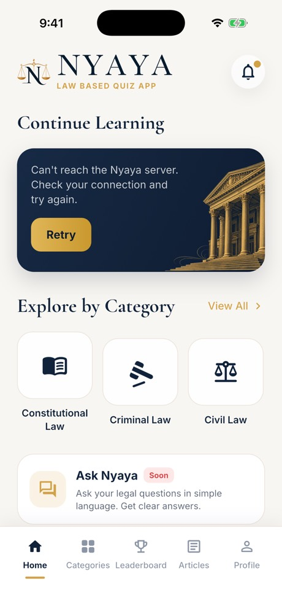 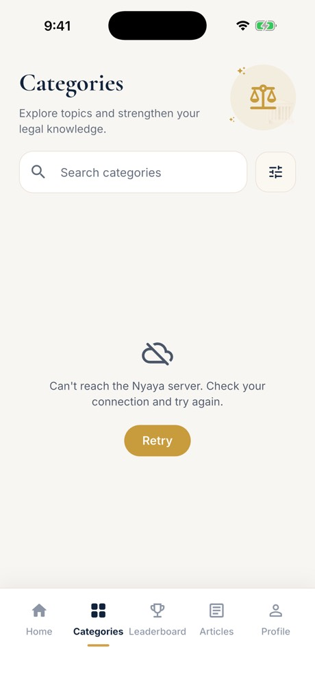 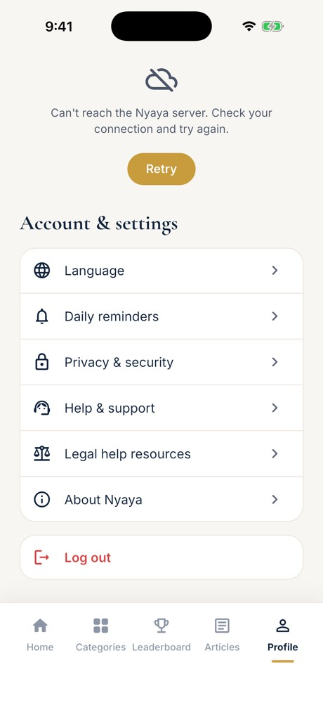 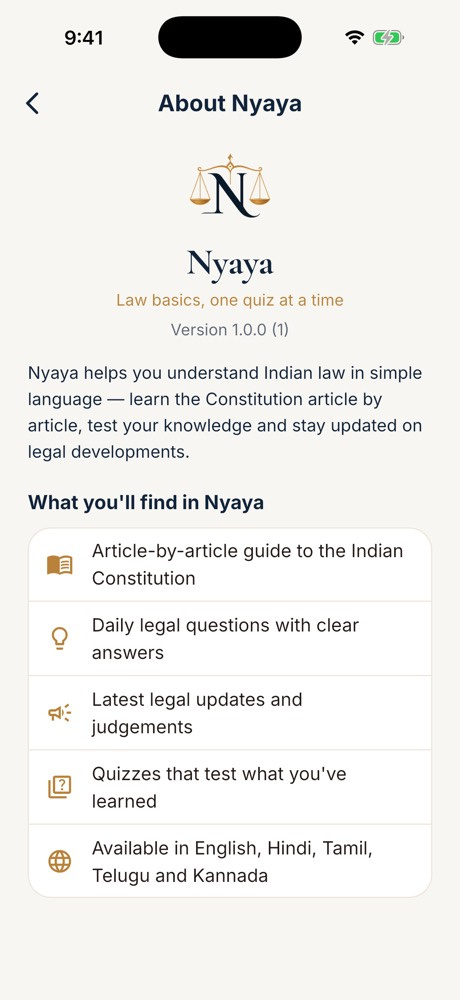

**After 035** (no bell, no Ask Nyaya or sample Popular Quizzes, no Filters button; backend offline):

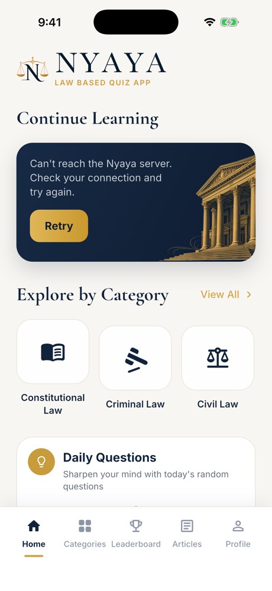 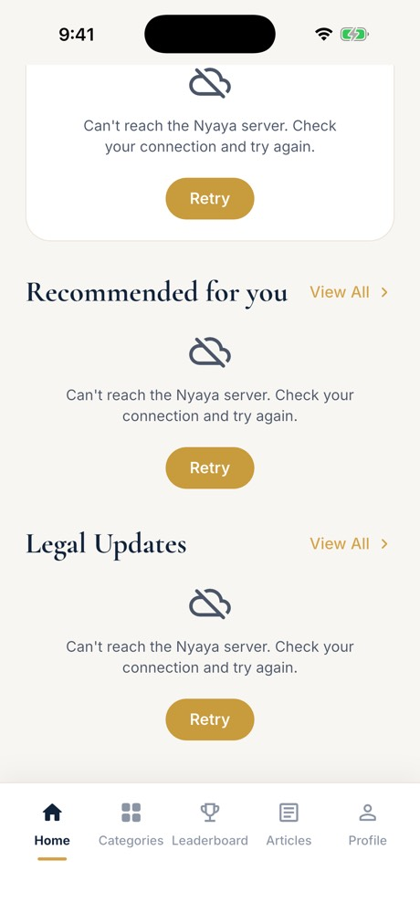 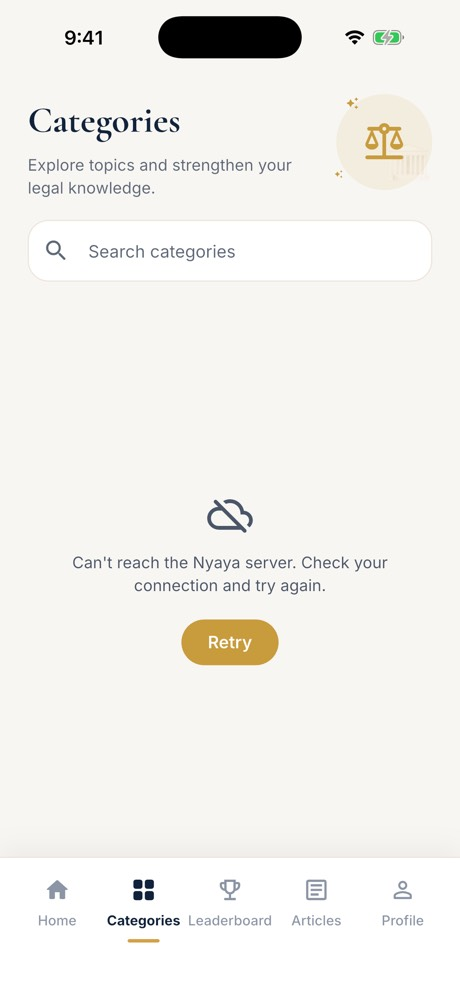

---

## 1. Verdict

The app does not feel premium. **The mockups do.** Most of the premium feel was lost when the mockups became Flutter code.

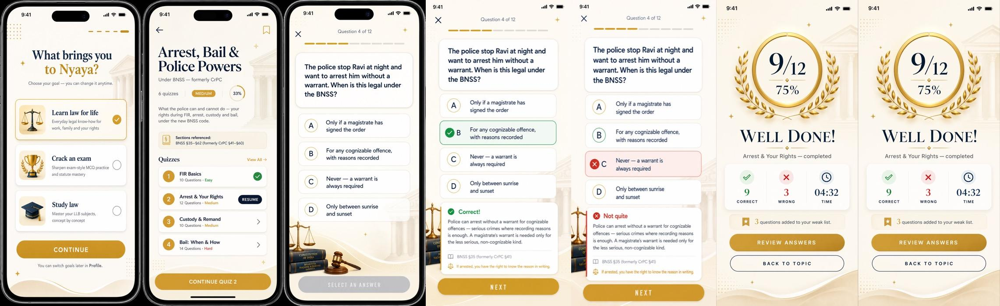

*Above: the target mockups (`/mockups`). Below: the same screens as built.*

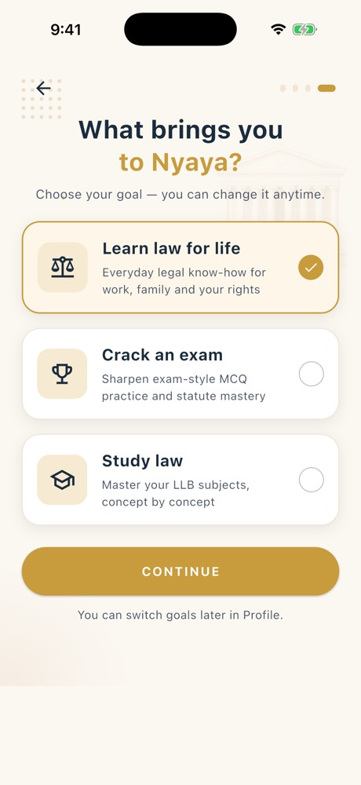 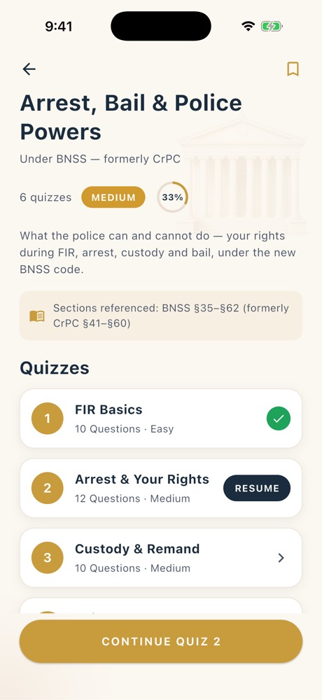 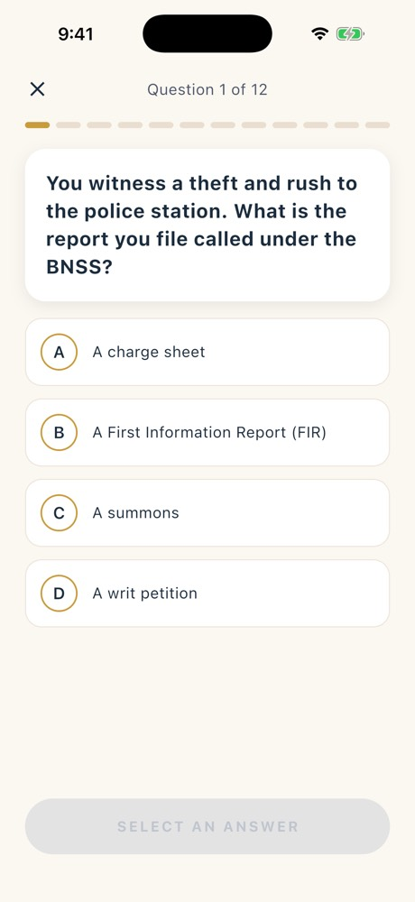 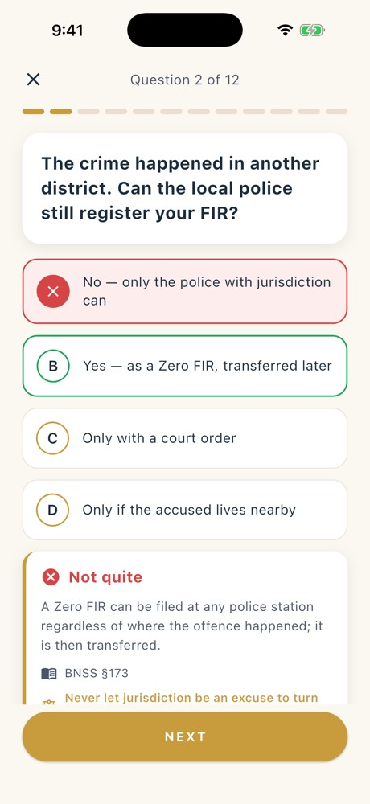 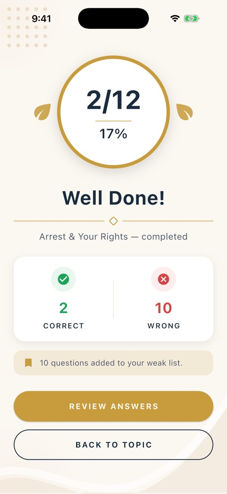

What the build lost, in order of impact:

1. **The serif typeface.** Every mockup heading uses a high-contrast serif ("What brings you to Nyaya?", "Arrest, Bail & Police Powers", "WELL DONE!"). The build ships **no fonts at all**, so everything renders in SF Pro. Twelve files ask for `fontFamily: 'serif'`, which iOS doesn't resolve, so they fall back to sans too. On its own, this explains most of the "generic app" feeling.
2. **Illustration and ornament.** The mockups have 3D gold objects (scales, trophy, cap), a laurel wreath, sparkles and a temple/book/gavel backdrop. The build replaces them with flat outline icons in beige squares and two loose "leaf" shapes.
3. **Too many dead ends.** 21 "coming soon" call sites. Tapping a category, a popular quiz, the bell, the filter button, Ask Nyaya or the Leaderboard tab shows a snackbar or an empty page. A premium product never answers a tap with "not yet".
4. ~~**The app contradicts itself.**~~ *(Fixed in 038: topic and quiz run on the backend, so Home, topic and Profile share one source.)* Home says "No quizzes yet" while the topic page shows quiz 1 done and 33% progress. Categories say "0 quizzes" while Popular Quizzes lists three. After you finish quiz 2, it still says "Resume". When the app looks unreliable, it also looks cheap.
5. **No design system.** 58 distinct hard-coded colors (5 navies, 7 golds), 19 font sizes, 16 corner radii, and a theme seeded from **orange** (`0xFFD66A33`). Every screen is close to the others but not quite the same.

---

## 2. Scorecard

| Area | Score /10 | Note |
|---|---|---|
| Brand & visual identity | ~~4~~ **5** | One navy, one gold family, one warm ivory since 036; illustration style still mixed |
| Typography | ~~3~~ **7** | Fixed in 034: serif + sans bundled, one type scale, no loose tracking. Still ~170 raw `TextStyle`s to move onto named styles |
| Color system | ~~4~~ **7** | Fixed in 036: token file, navy/gold scheme, muted tones, red only for errors |
| Layout & spacing | ~~6~~ ~~7~~ **8** | Alignment bugs fixed (037); Home leads with a greeting and real content (040); spacing tokens not yet adopted |
| Iconography & illustration | 4 | Three clashing styles: photoreal 3D, stock photo, outline icons |
| Motion & feedback | ~~2~~ **6** | 039: haptics on answer/result/tabs, answer and result animation, tab fade, sliding indicator, skeletons. Not felt on a device yet; no confetti |
| Content & copy | ~~5~~ **6** | Result headline now honest per score (037); some UI copy still off (sign-in, welcome) |
| Information architecture | ~~4~~ ~~5~~ ~~6~~ **7** | Category → topic → quiz now works end to end (038); one real category section on Home (040); Leaderboard still leads nowhere |
| State & trust | ~~3~~ ~~4~~ ~~5~~ **7** | Progress agrees everywhere and updates after a quiz (038); no right-answer reveal yet (backend gap) |
| Accessibility | ~~5~~ **6** | Respects reduce motion (039); text-scale and contrast gaps remain |
| **Overall** | ~~4.0~~ ~~4.4~~ ~~4.6~~ ~~5.0~~ ~~5.3~~ ~~5.6~~ ~~6.1~~ **6.3** | |

---

## 3. Root causes (fix these first — they touch every screen)

### 3.1 Typography

**Evidence**
- `pubspec.yaml`: the `fonts:` section is commented out. No `google_fonts` either.
- `fontFamily: 'serif'` / `'Serif'` (mixed case) in 12 files, e.g. `about_page`, `sign_in_page`, `otp_verification_page`, `articles_page`, `topic_detail_page`, `goal_selection_page`. None of them render as serif on iOS (see "Nyaya" on About, [18-about](screens/18-about.jpg)).
- 19 distinct `fontSize` values (10 → 46), including 11.5 and 13.5. Weight w700 is used 80 times, so everything is bold and nothing stands out.
- `ThemeData` keeps the Material 3 default text theme. Its tracking (bodyLarge +0.5, bodyMedium +0.25) was tuned for Roboto. On SF Pro it spreads body text out ("Explore laws, test your knowledge…" on Welcome).

**Fix**
- Bundle two families as assets (not runtime-loaded):
  - **Display serif** for headings, scores and the brand: *Cormorant Garamond* (closest to the mockups) or *Playfair Display*.
  - **UI sans** for body and controls: *Inter* or *Manrope*.
  - **Indic fallbacks**, because the app ships Hindi, Tamil, Telugu and Kannada: *Noto Sans/Serif Devanagari, Tamil, Telugu, Kannada* via `fontFamilyFallback`. Check every display heading in all five languages.
- Define one `TextTheme` and stop passing raw `fontSize`s. Suggested scale (pt): Display 34/40 serif · H1 28/34 serif · H2 22/28 serif · Title 17/24 sans 600 · Body 16/24 sans 400 · Body-S 14/20 · Caption 12/16 · Overline 11/14 sans 600 +1.2 tracking.
- Set letter-spacing to `0` for body text. Keep wide tracking only for overline/eyebrow labels. Drop the all-caps + 2–3 pt tracking from buttons ("CONTINUE QUIZ 2", "SELECT AN ANSWER"). Use sentence case at 16 pt / 600.

**Status: ✅ Done in [034](../../specs/features/034-brand-typography/spec.md) (2026-10-04)**
- Bundled **Cormorant Garamond** 500/600/700 and **Inter** 400–700 (OFL, ~2.2 MB) in `assets/fonts/`. The licenses appear on the app's licenses page.
- `lib/app/theme/app_typography.dart`: `NyayaFonts` plus one `TextTheme`. Display and headline styles use the serif, everything else uses Inter, and body text has zero tracking.
- All 24 broken `'serif'` references now use the brand serif. Section headings (Home, Profile), the profile name and stats, the article title, the filter sheet and the result score also use it. Serif sizes are about 15–25% larger to match the sans' visual size.
- Off-scale sizes removed (10, 11.5, 13.5, 19, 21): 19 → 16 distinct sizes.
- CTAs are sentence case at 16 pt / 600 with no tracking: Continue, Next, Select an answer, Continue quiz N, Resume, Get Started, Review answers, Back to topic.
- **Indic:** no bundled Noto. Hindi, Tamil, Telugu and Kannada use the system fonts as before; verified on the Language page ([screenshot](after-034/language-indic.jpg)).
- Tests: 5 new (`test/app/theme/app_typography_test.dart`), 6 updated for sentence-case labels and the taller article hero. `flutter analyze` is clean; 354/354 tests pass.
- **Not done (moved to step 8):** moving the ~170 raw `TextStyle(fontSize: …)` to named theme styles. The quiz result screen was not checked on device because the backend went offline (covered by widget tests).

### 3.2 Color system

**Evidence**
- `app_theme.dart` seeds `ColorScheme.fromSeed(0xFFD66A33)`, which is orange. Every Material default (focus rings, switches, progress, snackbars, ripples) inherits a color the brand doesn't use.
- Navies in use: `0E1C30`, `11233B`, `172A45`, `1A2C3D`, `1F2A37`. Golds: `C89B3C`, `B9823A`, `D3A247`, `D19A2E`, `C9982E`, `E0B657`, `C28135`.
- Categories uses blue / red / green / purple / orange / teal pastels ([10-categories](screens/10-categories.jpg)). That reads as a kids' edtech app, not a legal brand. Red for "Criminal law" and for "Hard" difficulty also reads as an error.
- The "Soon" pill is red ([07-home-top](screens/07-home-top.jpg)), so it looks like an error badge. *(The card is hidden since 035; fix the pill color before it returns.)*

**Fix**: one token file, explicit `ColorScheme` (no seed):

| Token | Value | Use |
|---|---|---|
| `ink` | `#11233B` | Primary text, primary surfaces |
| `inkMuted` | `#5E6878` | Secondary text |
| `gold` | `#C89B3C` | Brand accent, primary CTA |
| `goldDeep` | `#A97F2A` | Pressed state, gold text on ivory (passes AA at 18 pt+) |
| `ivory` | `#F8F6F2` | Page background |
| `surface` | `#FFFFFF` | Cards |
| `hairline` | `#ECE5DB` | Borders, dividers |
| `success` | `#1F8F55` | Correct |
| `danger` | `#C2412F` | Wrong / destructive only |

Give categories a **tonal** treatment (navy, gold, bronze, slate, olive, plum, all muted) or one ivory card with a gold glyph each. Never use red for a category or a difficulty level.

### 3.3 Surfaces, elevation, radius

- 16 radius values (1.2 → 30). Pick **3**: 12 (chips, inputs), 20 (cards), 999 (pills).
- **Card rendering bug**: `_PopularQuizCard` (`home_page.dart:479`) puts a `boxShadow` on an `Ink` decoration that has **no fill color**. The shadow shows through the card, which tints it grey, and gets clipped into square corners at the bottom ([08-home-middle](screens/08-home-middle.jpg), [09-home-bottom](screens/09-home-bottom.jpg)). Fix: `color: Colors.white` on the `Ink`, and move the shadow to an outer `DecoratedBox`.
- Use one elevation recipe: `0 8 24 rgba(17,35,59,0.06)` plus a 1 px hairline. Right now some cards have a border only, some a shadow only, some both.

**Status §3.2–3.3: ✅ Done in [036](../../specs/features/036-design-tokens/spec.md) (2026-10-06)**
- `lib/app/theme/app_tokens.dart` holds every color (`NyayaColors`, `NyayaTones`, `NyayaDifficulty`), radius (`NyayaRadii`), spacing step (`NyayaSpace`) and shadow (`NyayaShadows`).
- **Colors:** 58 scattered literals in 29 files became 0. All hex now lives in the token file: 26 brand colors plus 7 tint/ink tone pairs. 5 navies → `ink` (+ `inkDeep`/`inkRaised` for gradients), 7 golds → `gold`, `goldBright`, `goldDeep`, `goldTint`/`goldWash`.
- **Theme:** explicit navy/gold `ColorScheme` (no orange seed, no M3 surface tint). Shared themes for app bars, cards, inputs, progress and text selection. Snackbars now float on ink with rounded corners (fixes the §4 Global snackbar item).
- **Tones:** categories, legal-update chips and avatars use 7 muted tones (navy, bronze, slate, olive, plum, teal, clay) instead of rainbow pastels.
- **Red only means "wrong":** Hard difficulty → clay, Medium → deep gold. The "Soon" pill → gold.
- **Ivory:** unified on the warm `#FBF7F1` (the approved splash cream), so the splash golden didn't change.
- **Radii:** 16 values → 4 tokens (`xs` 6, `sm` 12, `md` 20, `pill`), used 88 times. 3 tiny ornament radii stay.
- **Card bug fixed:** the popular-quiz card is white, with its shadow outside the clipped material.
- **Guard:** `test/app/theme/design_tokens_test.dart` fails if a hex color appears outside `lib/app/theme/`.
- Tests: 4 new, 3 updated (avatar tone; 2 profile URL tests now follow `ApiConfig`). `flutter analyze` is clean; 363/363 tests pass.
- **Not done:** spacing tokens aren't adopted yet (0 uses), and 10 ad-hoc `BoxShadow`s remain. **No device check:** the simulator was off at the owner's request, so the new tones and the card fix aren't confirmed visually (widget and golden tests pass).

### 3.4 Motion & haptics

- `HapticFeedback` is used **0** times. Add `selectionClick` on option tap, `lightImpact` on correct, `mediumImpact` on wrong, `heavyImpact` on the result.
- Only 5 animation durations in the codebase. Missing:
  - Answer reveal: the option scales to 0.98 → 1, the color cross-fades, and the explanation slides up (250 ms, `easeOutCubic`).
  - Result: the score counts up, the ring fills, then a subtle gold sparkle.
  - Page transitions: use the Cupertino slide on iOS. Today some routes fade and some slide.
  - Tab switch: a cross-fade, not a hard cut.
  - Skeleton shimmer for loading. Loading is a bare `CircularProgressIndicator` (8 places).
- The bottom nav indicator should slide between tabs, not jump.

**Status §3.4: ✅ Done in [039](../../specs/features/039-motion-haptics/spec.md) (2026-10-06)**
- `lib/app/theme/app_motion.dart`: `NyayaMotion` (150/250/600 ms, `easeOutCubic`, zero when the OS asks to reduce motion) and `NyayaHaptics` (select, correct, wrong, celebrate).
- **Haptics:** answer pick → selection click; right → light; wrong → medium; result ≥ 70% → heavy, otherwise a selection click (a heavy buzz for a low score would feel like a penalty); tab switch → selection click.
- **Motion:** options ease into their verdict color; the explanation slides up; the result score and percent count up and the headline settles in; tabs fade in; one nav indicator slides between tabs; loading shows a pulsing skeleton instead of a spinner; routes use the iOS slide and Android fade-forwards.
- Tests: 6 new (`test/app/theme/motion_test.dart`), 1 updated (loading now shows a skeleton). `flutter analyze` is clean; 393/393 tests pass.
- **Not done:** confetti/sparkle (needs art), spinners inside buttons and the dark progress card, a frosted nav bar. **Not felt yet:** haptics and timing need a real phone (simulator off).

### 3.5 Illustration language

There are three styles fighting each other:

- photoreal 3D: the Welcome book and gavel, the home temple card
- stock photo: the Articles hero (Lady Justice)
- flat outline icons: everywhere else

Pick the **3D gold set from the mockups** for hero moments (onboarding, goals, empty states, results). Use **one** outline icon family (Phosphor or Lucide, 1.5 px stroke) for UI. Remove the stock photo.

### 3.6 Dead ends and trust

| Tap | Result at audit | Status (035, 2026-10-05) |
|---|---|---|
| Category tile (Home and Categories) | "X coming soon." snackbar ([11](screens/11-category-tap-coming-soon.jpg)) | ✅ Categories tab and Recommended open the topic (038). Home's sample strip was removed in 040. |
| Popular quiz card | "X coming soon." ([09b](screens/09b-popular-quiz-coming-soon.jpg)) | ✅ Section hidden (cards were sample data) |
| Bell (with a gold unread dot) | "Notifications coming soon." | ✅ Hidden, dot included |
| Filter button | "Filters coming soon." ([24](screens/24-filter-coming-soon.jpg)) | ✅ Hidden; search is full width |
| Ask Nyaya card | "Ask Nyaya coming soon." | ✅ Hidden |
| Leaderboard tab | Full-page placeholder ([12](screens/12-leaderboard.jpg)) | **Kept** (owner decision: 5 tabs) |
| Review answers (result) | Nothing. `onReviewAnswers: () {}` in `main_shell.dart` | ✅ Hidden; Back to topic becomes the primary button |
| Read article | The body only repeats the title ([15](screens/15-article-reader.jpg)) | Open (content/backend) |

**Rule:** if a feature isn't ready, **hide its entry point**. Since 035 a control shows only when its handler is wired, so wiring a feature brings its button back with no other change.

---

## 4. Screen-by-screen findings

Severity: **P0** broken or very visible · **P1** clearly hurts the premium feel · **P2** polish.

### Splash · [01](screens/01-splash.jpg)
- **P1** The splash waits for a tap ("temporary review mode", `splash_bootstrap.dart`) but gives no hint. Users will think it froze. Auto-advance after load.
- **P2** The progress bar fills, then nothing happens. Fade into the next screen.

### Welcome · [02](screens/02-welcome.jpg)
- **P1** The headline is in sans; the mockup brand is serif. "Justice Made Accessible." in bright gold on ivory has weak contrast.
- **P1** The three feature columns have uneven heights (2- vs 3-line titles), and the icons sit in grey circles. That's generic.
- **P1** "Track case status" promises a feature the app doesn't have.
- **P2** ~~"Get Started" is letter-spaced~~ (fixed in 034). The brand lockup sits low, leaving dead space above.

### Sign in · [05](screens/05-sign-in.jpg)
- **P0** ~~The phone field accepts unlimited digits~~. Fixed in 037: `+91` prefix, digits only, max 10, and a clear message for anything but 10 digits (sign-up too). Inline errors are still to do.
- **P1** The error is only a dark snackbar ("Invalid credentials"); nothing inline. There is no "Forgot password".
- **P1** No back button from sign-in to Welcome.
- **P1** About 35% of the screen above the logo is empty. The Login button is narrower than the fields, which is unusual.
- **P2** Copy: "Welcome Back to NYAYA !" has a space before the "!". "Rejoin NYAYA and start your… journey" is a mixed message. "Signup" should be "Sign up".

### Goal selection · [06](screens/06-goal-selection.jpg)
- **P1** Closest to the mockup, but the 3D illustrations became small icons, and the heading lost the serif.
- **P1** The back arrow sits on top of the dot pattern. The progress dots show step 4/4 right after login, which is confusing.
- **P1** The background gradient stops in a hard horizontal line about 80% down.
- **P2** You pick "Learn law for life", yet Profile still says "Law Student".

### Home · [07](screens/07-home-top.jpg) · [08](screens/08-home-middle.jpg) · [09](screens/09-home-bottom.jpg)
- **P0** ~~Popular quiz titles break mid-word~~. Fixed in 037: the title gets the full width (2 lines max) and the rating is a small pill in the meta row. Not seen on device yet (section hidden since 035).
- **P0** ~~The grey card fill and square shadow corners~~ (fixed in 036).
- **P0** ~~"No quizzes yet" stays after you finish a quiz~~. Fixed in 038: quizzes submit to the backend and Home reloads.
- **P1** ~~The header wordmark takes about 15% of the first screen~~. Fixed in 040: a small logo, "Good evening" plus the first name, and a streak chip (hidden at zero).
- **P1** ~~Section order puts placeholders (Ask Nyaya "Soon") above real content~~. Ask Nyaya and sample Popular Quizzes were hidden in 035. When real quizzes return, order: Continue → Daily question → Popular → Categories → Updates. ✅ This order is in place since 040.
- **P1** *(found in 035)* When the backend is unreachable, Home shows four identical "Can't reach the Nyaya server" blocks with four Retry buttons ([after-035](after-035/home-lower.jpg)). Show one offline banner with one Retry instead.
- **P1** ~~Two category sections~~. Fixed in 040: one "Explore by Category" section with backend cards; View All opens the Categories tab; the sample strip and the see-all grid are gone.
- **P1** ~~The 3 category tiles aren't aligned~~. Fixed in 037 (top-aligned row).
- **P1** The quiz icons don't match the topic (a chain-link icon for IPC). Retry buttons come in two styles (gold gradient + navy text vs flat gold + white text).
- **P2** Error states use a generic "!" circle and "Something went wrong". Say what failed and offer cached content.

### Bottom navigation (all tabs)
- **P0** ~~"Leaderboar / d" wraps onto two lines~~. Fits since 034; since 037 labels are guaranteed one line and shrink to fit in any language.
- **P1** ~~The selected label turns bold and shifts the row~~. Fixed in 037 (one weight; only color changes).
- **P2** No translucent blur. A frosted bar (`BackdropFilter`, ~90% ivory) reads as more native and premium.

### Categories · [10](screens/10-categories.jpg) · [11](screens/11-category-tap-coming-soon.jpg)
- **P0** Every card shows "0 quizzes", and every tap says "coming soon".
- **P1** ~~Rainbow pastels~~ (muted tones since 036).
- **P2** The header illustration (a scale in a beige circle) is placeholder-level.

### Leaderboard · [12](screens/12-leaderboard.jpg)
- **P0** A whole tab that is "Coming soon". **Owner decision (2026-10-05): keep the tab.** At least make the placeholder richer (preview of ranks, "be the first" message).

### Articles · [13](screens/13-articles.jpg) · [14](screens/14-article-expanded.jpg) · [15](screens/15-article-reader.jpg)
- **P0** The reader shows only a one-line body (the title repeated). The expanded card also repeats the title, so you tap twice and learn nothing.
- **P1** The stock-photo hero clashes with the rest of the app.
- **P1** Every item uses the same building icon, alternating navy and gold, which adds noise. Number badges ("Art. 1") would carry more meaning.
- **P1** "1. Name and territory…" plus "Article 1" says the number twice.
- **P1** The reader needs reading typography: serif body 18/30, max ~65 characters per line, plus bookmark, share, text size, a "Take the quiz on this" call to action, and next/previous article.
- **P2** Two nav-bar title styles: bold here, light on About ([18](screens/18-about.jpg)).

### Topic detail · [19](screens/19-topic-detail.jpg)
- **P0** ~~The data looks hard-coded~~. Fixed in 038: the topic is a real category, with statuses and percent from your attempts, reloaded after each quiz.
- **P1** "Resume" starts at question 1. *Still true after 038:* Continue starts a fresh attempt. True resume needs the open attempt's answered questions.
- **P1** Two buttons do the same thing (the Resume pill and Continue quiz 2). Keep the bottom button. *(Still open; the pill is now only a status marker, but it still reads as a button.)*
- **P1** *(found in 038)* After a wrong answer the app can't highlight the right option: the backend withholds the answer key and `POST /quiz-attempts/:id/answers` only returns right/wrong. **Backend ask:** return `correctOptionId`.
- **P1** *(found in 038)* A floating error snackbar sits on top of the quiz footer, so "Next" (used to retry a failed submit) can't be tapped for ~4 s. Give the quiz page an inline error, or lift snackbars above bottom buttons.
- **P2** The bookmark button was removed in 038: it never saved anything (spec 035 rule).
- **P2** The list is cut off hard behind the bottom button. Add an ivory gradient fade.

### Quiz question · [20](screens/20-quiz-question.jpg) · [21](screens/21-quiz-selected.jpg) · [22](screens/22-quiz-answer-2.jpg)
- **P0** ~~The explanation card is cut off under the Next button~~. Fixed in 037: it scrolls into view after an answer, and each question starts at the top.
- **P1** ~~Feedback is instant and silent~~. Since 039: haptics plus eased option colors and a sliding explanation.
- **P1** The progress bar doesn't separate answered from current, or right from wrong. Use gold for current, filled for done, and a small red or green tick under each segment.
- **P1** The disabled "SELECT AN ANSWER" button is grey-on-grey with low contrast. Hide it until an answer is chosen, or use an outline style.
- **P2** The left gold accent on the explanation card is drawn as a partial border and looks broken at the corner.
- **P2** No topic name or timer in the header (the mockup result shows a time stat).

### Quiz result · [23](screens/23-quiz-result.jpg) vs mockup

 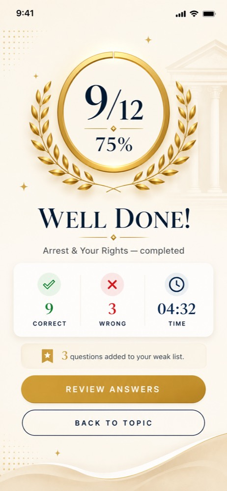

- **P0** ~~"Well Done!" shows for 2/12 (17%)~~. Fixed in 037: ≥70% "Well Done!" (matches the mockup's 9/12), 40–69% "Good progress!", <40% "Keep going!", in all 5 languages.
- **P0** ~~"Review answers", the main button, does nothing~~. Hidden in 035 until answer review exists; Back to topic is now the filled primary button.
- **P1** The mockup has a laurel wreath, a serif display score, and a Time stat. The build has two leaf blobs and sans numerals.
- **P1** The dot pattern overlaps the status bar time.
- **P2** ~~No count-up or haptic at the result~~ (039: count-up, headline entrance, haptic by score). Confetti still needs art.

### Profile · [16](screens/16-profile.jpg) · [17](screens/17-profile-lower.jpg)
- **P1** Four big "0" tiles feel demotivating for a new user. Show one invitation instead: "Finish your first quiz to start a streak 🔥".
- **P1** Gold stat icons vs navy settings icons, and full-width dividers inside a rounded group.
- **P2** "Log out" is a large red card. Make it a quiet text row at the bottom, with the version number under it.

### About · [18](screens/18-about.jpg)
- **P1** ~~The brand name is in sans~~ (serif since 034). The tagline still differs: "Law basics, one quiz at a time" vs "LAW BASED QUIZ APP". Pick one tagline.

### Global
- **P1** ~~The snackbar is the default Material style~~. Since 036 it floats on ink with rounded corners. Still to add: an icon.
- **P1** No dark mode (`darkTheme` is never set). It's expected in a premium iOS app.
- **P2** Text scale: only one widget reads `textScalerOf`. Test at 130% and 200%. The home category tiles and bottom nav will break.

---

## 5. Priority plan

### Week 1 — "Stop looking broken" (P0)
1. ✅ (035) Hide unfinished entry points: bell + dot, filter, Ask Nyaya, Popular Quizzes, Review answers. Leaderboard tab and category taps kept by owner decision.
2. ✅ Fix the card fill/shadow bug (036), the mid-word title breaks, the category tile alignment and the nav label wrap (037).
3. ✅ Clamp the phone input (`+91` prefix, 10 digits) (037). Inline errors still to do.
4. ✅ Make the result headline depend on the score (037). ~~Wire "Review answers" or remove it~~ (hidden in 035).
5. ✅ Keep the explanation visible above the quiz footer (037).
6. ✅ (038) Connect topic, home and profile progress to one source of truth: real quizzes and attempts on the backend.

### Weeks 2–3 — "Design system" (root causes)
7. ✅ `lib/app/theme/`: ~~color tokens, an explicit `ColorScheme`~~ (036), ~~a `TextTheme`~~ (034), ~~spacing, radii, elevation tokens~~ (036).
8. ~~Replace the 58 color literals~~ ✅ (036, with a guard test). Still to do: the ~170 raw `TextStyle` font sizes → named styles, spacing → `NyayaSpace`, 10 shadows → `NyayaShadows`.
9. Shared widgets: `NyayaButton` (primary/secondary/ghost), `NyayaCard`, `NyayaToast`, `NyayaSkeleton`, `NyayaEmptyState`.

### Weeks 3–4 — "Feel premium" (P1)
10. Bring back the mockup art: 3D gold goal icons, laurel result, serif display headings.
11. ✅ Motion + haptics pass (039).
12. ✅ ~~Rework the Home layout: greeting, streak, then content-first order~~ (040).
13. Article reader typography and actions.
14. ✅ Muted tonal category palette (036).

### Later (P2)
15. Dark mode, a frosted nav bar, text-scale QA, an Indic typography QA pass for all five languages.

---

## 6. How this audit was done
- Walked every reachable screen on the simulator, signed out and signed in: splash → welcome → sign in → goal → 5 tabs → topic → full 12-question quiz → result → profile → about.
- Static scan of `lib/` for colors, font sizes, weights, radii, durations, haptics, `Semantics`, and coming-soon stubs.
- Compared against the 7 mockups in `/mockups`.
- Screenshots are in `docs/ui-audit/screens/`.
- **Not covered:** sign-up/OTP flow, Language, Reminders, Privacy, Help pages, Hindi/Tamil/Telugu/Kannada rendering, Android, iPad, and VoiceOver.

## 7. Unresolved questions
- Are the mockups the agreed target, or only inspiration?
- ~~Is a font license budget OK?~~ Answered by 034: free OFL fonts (Cormorant Garamond, Inter).
- ~~Hide Leaderboard and Ask Nyaya?~~ Answered 2026-10-05: keep Leaderboard; Ask Nyaya hidden (035).
- Is the topic-detail data meant to be mock data for now?
- Should dark mode be in scope for v1?
